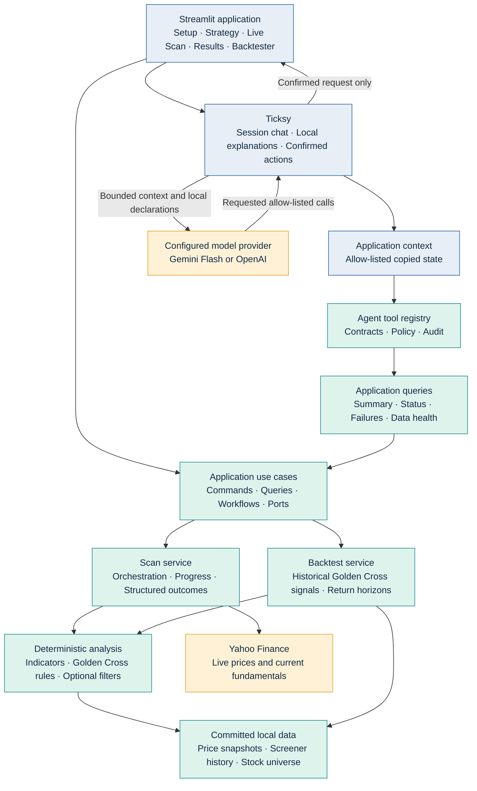

# Architecture

Stock Analyser YF is organized as a production-oriented layered application.

```text
Streamlit UI
    ↓
Application Commands and Workflows
    ↓
Temporary Service Facades and Domain Rules
    ↓
Provider Ports and Current Adapters
    ↓
Yahoo Finance, Screener Snapshots, Cache, and Observability
```

## High-Level Design



Ticksy can call the configured model provider only with bounded conversation
context and approved local results. It has no browser, news, RAG, or external
market-data tools; all calculations and rule decisions remain in Python.

## Agentic Application Boundary

The agentic foundation is deliberately an orchestration layer, not a second
calculation engine. `ApplicationContext` copies only approved scan, Backtester,
settings, timing, and snapshot fields; the packaged `ExecutionContext` wraps
that contract for agent use. Agent tools receive only this read-only snapshot
and call deterministic application queries. They do not receive Streamlit
state, secrets, providers, filesystem access, or network clients.

Every discoverable operation declares an effect and approval level. The
central policy requires no approval for read-only queries, user confirmation
for session mutation, expensive computation, or external side effects, and
administrator confirmation for production operations. The registry rejects a
tool definition that weakens this policy, validates each call's arguments, and
returns a structured result. Its audit boundary records sanitized arguments,
approval, status, timing, and snapshot identity without storing credentials.

Ticksy can now let its configured provider select from the registered
read-only analysis tools. The application validates and executes no more than
three calls, then supplies their structured results for the final response.
Existing scan and Backtester actions continue through the current explicit-
confirmation flow. Planning, email, refresh, Git, and deployment tools remain
unavailable until separately designed and tested.

## Package Structure and Migration Rule

```text
app.py                              Thin Streamlit Cloud bootstrap
src/stock_analyser/
    domain/scanning/                Pure scan models, indicators, rules, and scoring
    domain/markets/                 Market identity and dataset-location rules
    domain/fundamentals/            Fundamental outcomes and reusable calculations
    domain/backtesting/             Historical replay, horizons, returns, and summaries
    domain/reporting/               Report data, specifications, batching, and content
    application/                    Commands, queries, workflows, context, and ports
    agents/                         Canonical orchestrator, policy, audit, and tools
    infrastructure/                 Yahoo, Screener, R2/local, SMTP, and model adapters
    presentation/streamlit/
        app.py                      Packaged Streamlit composition root
        pages/                      Setup, Strategy, Live Scan, Results, and Backtester
        components/                 Theme, filters, insights, charts, reports, and Ticksy
        session_adapter.py          Only raw Streamlit session-state boundary
    jobs/                           Packaged refresh, housekeeping, and alert entrypoints
stock_analyser/                     Temporary source-checkout package shim
application/, agents/               Temporary compatibility exports
core/, models/                      Temporary compatibility imports
providers/, services/, ui/         Compatibility exports and temporary orchestration
scripts/                            Temporary job launchers and focused maintenance tools
tests/
    domain/                         Pure rule and calculation tests
    application/                    Command, query, workflow, and port tests
    agents/                         Ticksy runtime and policy tests
    infrastructure/                 Offline adapter and storage contracts
    integration/                    Scanner, jobs, reporting, and Streamlit smoke tests
    support/                        Shared deterministic fixtures and fakes
```

The installable package uses the `src` layout declared in `pyproject.toml`.
Migration remains incremental: existing imports are compatibility facades or
unchanged modules until their own focused sprint. Streamlit now invokes scan,
Backtest, strategy-update, and report-delivery commands/workflows. Registered
Ticksy tools invoke packaged application queries instead of service helpers.
The packaged agent runtime owns orchestration, execution context, contracts,
approval decisions, policy, audit, provider-neutral prompts, and focused local
tools. Root `agents/`, `application/assistant_runtime.py`, and
`services/assistant_context.py` retain compatibility exports only. The packaged
Streamlit composition root now dispatches focused page controllers, reusable
components, and a single session adapter; root `ui/` modules alias those
canonical modules for temporary import compatibility.
Scheduled market refresh, Screener refresh, storage housekeeping, and failure
notification now run from `stock_analyser.jobs`. These entrypoints sequence work
through the application refresh workflow and accept injected infrastructure
collaborators. GitHub Actions uses `python -m stock_analyser.jobs...`; matching
root scripts remain thin compatibility launchers during rollout.
Market identity, currency, timezone, stock keys, and market-specific dataset
locations are canonical under `stock_analyser.domain.markets`;
`models/market.py` is now a compatibility export. Reusable fundamental
calculations and typed outcomes are canonical under
`stock_analyser.domain.fundamentals`.
Historical replay models, Post-Cross qualification, fixed horizons, valuation
selection, forward-return calculations, and aggregate metrics are canonical
under `stock_analyser.domain.backtesting`. The application Backtest command
coordinates market-data and Screener ports directly; `services/backtest_service.py`
and `models/backtest.py` remain compatibility facades.
Recipient validation, filters-first workbook data, chart specifications,
attachment batching, and report-message content are canonical under
`stock_analyser.domain.reporting`. Excel/PNG/ZIP rendering stays in the
temporary report service, and SMTP delivery stays in infrastructure.
The scanner's pure models,
indicators, Post-Cross rules, Impending rules, reversal rules, optional rules,
and scoring now live under `stock_analyser.domain.scanning`; `ScanService`
remains the temporary provider-aware orchestration facade. A parity script runs
the refactored and pre-refactor scanners against the same ranked universe and
snapshot before this compatibility layer is retired.

## Current Components

- `src/stock_analyser/presentation/streamlit/app.py`: composition root for page
  configuration, workflow navigation, and canonical page dispatch.
- `src/stock_analyser/presentation/streamlit/pages/`: Setup, Strategy, Live
  Scan, Results, Backtester, and Introduction page controllers.
- `src/stock_analyser/presentation/streamlit/components/`: shared theme,
  session-only strategy controls, local insights, stock charts, result/report
  components, and the Ticksy launcher.
- `src/stock_analyser/presentation/streamlit/session_adapter.py`: the only
  presentation module that reads or writes raw `st.session_state`; page and
  component code uses its mutable mapping boundary.
- `ui/`: temporary module aliases preserving established imports while hosted
  and test callers use canonical packaged presentation paths.
- `src/stock_analyser/application/context.py`: canonical allow-listed, copied
  application state for agent tools and hosted-provider context construction.
  The root `application/context.py` is a temporary compatibility export.
- `src/stock_analyser/application/commands/`: explicit scan, Backtest,
  strategy-update, and report-delivery use cases. The Backtest command now
  orchestrates the pure Backtesting domain and injected provider ports; scan
  orchestration still uses its temporary service facade.
- `src/stock_analyser/application/queries/`: deterministic scan summary, stock
  status, failure explanation, calculation trace, and data-health queries used
  by Ticksy's registered local tools.
- `src/stock_analyser/application/workflows/`: provider-bundle orchestration for
  scans and Backtests plus provider-independent refresh sequencing.
- `src/stock_analyser/application/ports/`: structural contracts for market
  data, fundamentals, storage, mail, and hosted-model providers. The Phase 1
  market, fundamentals, storage, and mail contracts and the hosted-model
  contract are runtime-checkable and independent from concrete providers.
- `src/stock_analyser/infrastructure/data_services.py`: the provider
  composition factory. It returns a bundle typed by application ports and
  consistently selects live Yahoo or pinned local/cloud snapshot adapters.
- `src/stock_analyser/infrastructure/yahoo/`: canonical Yahoo history,
  fundamentals, classification, market-cap, peer-group, and industry-
  valuation adapters.
- `src/stock_analyser/infrastructure/screener/`: canonical bounded-retry
  Screener.in company-page and valuation-history adapter.
- `src/stock_analyser/infrastructure/r2/`: canonical local, scoped, and
  R2/S3 snapshot storage plus repository-backed history, fundamentals,
  industry-valuation, and Screener adapters.
- `src/stock_analyser/infrastructure/smtp/`: authenticated SMTP implementation
  of `MailerPort`, shared by report delivery and refresh-failure alerts.
- `src/stock_analyser/infrastructure/gemini/` and
  `src/stock_analyser/infrastructure/openai/`: canonical hosted-model adapters
  responsible for provider request conversion, local-tool declarations,
  response parsing, and transport-error normalization. Neither adapter enables
  provider-hosted search, browsing, code execution, or file retrieval.
- `src/stock_analyser/infrastructure/model_support.py`: provider-neutral tool-
  schema conversion helpers shared by the model adapters.
- `src/stock_analyser/agents/orchestrator.py`: session-isolated orchestration
  for provider tool selection, validated local execution, grounding, and data-
  used metadata.
- `src/stock_analyser/agents/execution_context.py`: agent-facing wrapper over
  the allow-listed copied `ApplicationContext`, including bounded provider
  context serialization.
- `src/stock_analyser/agents/tool_registry.py`, `approvals.py`, `policies.py`,
  and `contracts.py`: typed discovery, validation, effect classification, and
  centralized approval enforcement.
- `src/stock_analyser/agents/audit_log.py`: sanitized session-local audit
  events with snapshot and timing metadata.
- `src/stock_analyser/agents/prompts/`: versioned local-data-only provider
  instructions shared by Gemini and OpenAI adapters.
- `src/stock_analyser/agents/tools/`: focused scan, Backtester, explanation,
  data-health, and reserved reporting tool modules over application queries.
- `src/stock_analyser/domain/scanning/models.py`: canonical immutable scan and
  optional-filter configuration plus typed Post-Cross, Impending-Cross, and
  failed outcomes. Existing `models/` paths re-export these contracts.
- `src/stock_analyser/domain/scanning/`: provider-independent indicators,
  Post-Cross, Impending, reversal, optional-filter, and scoring rules.
- `src/stock_analyser/domain/markets/`: explicit India/US market definitions,
  currency and timezone metadata, country-qualified stock keys, and isolated
  dataset-root selection. It contains no provider client or network logic.
- `src/stock_analyser/domain/fundamentals/`: typed three-state comparison and
  industry-valuation outcomes plus pure CAGR, P/E, PEG, debt-to-equity,
  financial-company classification, numeric-validation, and peer-valuation
  calculations.
- `src/stock_analyser/domain/backtesting/`: typed replay outcomes, fixed
  trading-session horizons, historical Post-Cross qualification, point-in-time
  P/E selection, forward returns, and aggregate return metrics.
- `src/stock_analyser/domain/reporting/`: typed report and chart specifications,
  recipient validation, filters-first workbook frames, attachment batching,
  and message subject/body construction without SMTP or rendering dependencies.
- `services/scan_service.py`: scan orchestration with injected provider
  dependencies, structured failures, and optional accumulated-result callbacks
  for batched UI progress updates. Mandatory technical rules run before
  selected fundamental filters.
- `services/fundamental_filters.py`: temporary compatibility path for the
  scanning optional rules. Their provider-independent comparison outcomes and
  reusable calculations come from the Fundamentals domain.
- `providers/yahoo_finance.py`, `providers/repository_data.py`,
  `providers/screener.py`, `core/fundamentals.py`,
  `services/industry_valuation.py`, `services/snapshot_storage.py`,
  `services/storage_config.py`, and `services/data_source.py`: temporary
  compatibility exports for callers that have not yet migrated to canonical
  infrastructure imports.
- `services/scan_report.py`: compatibility and rendering facade for XLSX, PNG,
  ZIP, and `EmailMessage` creation. Report data, validation, batching decisions,
  and message content come from the Reporting domain; SMTP delivery is delegated
  through the infrastructure `MailerPort` adapter. The Streamlit UI supplies
  completed results and deployment-managed secrets; recipients are never persisted.
- `services/assistant_provider.py`: temporary configuration and compatibility
  facade that selects the canonical Gemini or OpenAI adapter, or a safe
  disabled provider when credentials are unavailable.
- `services/assistant_tools.py`, `services/assistant_context.py`,
  `services/assistant_explanations.py`, and `services/assistant_actions.py`:
  bounded local context, deterministic explanations, and confirmed scan or
  Backtester action proposals.
- `models/assistant.py` and `models/assistant_action.py`: typed conversation,
  configuration, request, and proposed-action contracts.
- `src/stock_analyser/jobs/_market_snapshot_refresh.py`: full backfill,
  incremental append, universe reconciliation, symbol-grouped Parquet
  optimization, semiannual
  classifications, industry P/E calculation, coverage reporting, and atomic
  manifest updates. It calculates backend-only PEG from refreshed Yahoo P/E
  and committed Screener 3-year profit growth.
- `.github/workflows/refresh-market-data.yml`: scheduled and manual R2 snapshot
  validation and atomic-publication workflow, with failure email notification
  through repository-managed Gmail SMTP secrets.
- `src/stock_analyser/jobs/screener_refresh.py`: one throttled, resumable,
  batch-checkpointed refresh for every Screener-derived field and chart
  observation. It publishes versioned files through an atomic manifest and can
  restore the completed checkpoint for a failed-record-only next-day retry.
- `.github/workflows/refresh-screener-fundamentals.yml`: monthly/manual
  Screener refresh, validation, commit, and failure-alert workflow.
- `src/stock_analyser/jobs/market_refresh.py`: scheduled R2 staging,
  validation, no-change detection, atomic publication, and post-publication
  verification for market and Screener datasets.
- `src/stock_analyser/jobs/storage_housekeeping.py`: plan-first R2 retention
  and local-cache cleanup; applying a change still requires an exact reviewed
  plan ID.
- `src/stock_analyser/jobs/refresh_alert.py`: authenticated SMTP failure-alert
  entrypoint with credentials supplied only by deployment secrets.
- `scripts/refresh_cloud_market_data.py`, `scripts/refresh_market_data.py`,
  `scripts/refresh_screener_fundamentals.py`,
  `scripts/storage_housekeeping.py`, and
  `scripts/send_refresh_failure_email.py`: thin compatibility launchers for
  existing local commands; they contain no operational behavior.
- `core/data_loader.py`: symbol-universe loading and batch price retrieval.
- `core/scanner.py`: compatibility facade for legacy callers.
- Technical-analysis modules: indicators, Golden Cross, Short/Long-MA
  trajectories, pre-cross proximity and validation, and 52-week Long-MA
  high-to-trough recovery validation.
- `services/stock_universe.py`: resolves only the manifest-selected validated
  universe; no legacy symbol-file fallback is permitted.
- `core/fundamentals.py` and `services/industry_valuation.py`: compatibility
  exports for the canonical Yahoo adapters.
- Committed classifications are maintained separately from daily fundamentals,
  preventing routine refreshes from erasing sector and industry values.
- `models/`: typed scan and failure-result contracts.

## Target Reliability Boundaries

- The UI must not contain market-data or scanner business logic.
- Normal scans and selected-stock chart expansion must not call Screener live;
  both read only the committed Screener snapshot.
- Every external request must have an observable success or failure outcome.
- Every scanned symbol must finish as either a qualified result or a structured
  failure result.
- Caches are an optimization only; results must identify their scan time and
  selected settings.
- User-named strategies are presentation/session state only. They must not
  mutate code-defined defaults or be persisted to Git.
- Report recipients remain session-only and SMTP credentials are read only
  from Streamlit Secrets or local environment variables.
- Optional filters start empty, persist through Streamlit reruns and named
  session strategies, and never create a third result group for missing data.
- Ticksy may send only bounded conversation context and approved local results
  to its configured model provider. Its Python tools never browse, fetch
  market data, use news, or use RAG; calculations remain deterministic Python
  services.
- Agent tools never receive raw Streamlit session state or secrets. New tools
  must declare their effect and cannot use an approval weaker than the central
  policy permits.
