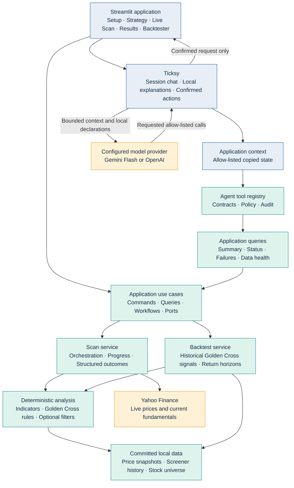

# Architecture

Stock Analyser YF is organized as a production-oriented layered application.

```text
Streamlit UI
    ↓
Application Commands and Workflows
    ↓
Temporary Service Facades and Domain Rules
    ↓
Provider Ports and Current Adapters
    ↓
Yahoo Finance, Screener Snapshots, Cache, and Observability
```

## High-Level Design



Ticksy can call the configured model provider only with bounded conversation
context and approved local results. It has no browser, news, RAG, or external
market-data tools; all calculations and rule decisions remain in Python.

## Agentic Application Boundary

The agentic foundation is deliberately an application layer, not a second
calculation engine. `ApplicationContext` copies only approved scan, Backtester,
settings, timing, and snapshot fields. Agent tools receive that read-only
snapshot and call existing deterministic query functions; they do not receive
Streamlit state, secrets, providers, filesystem access, or network clients.

Every discoverable operation declares an effect and approval level. The
central policy requires no approval for read-only queries, user confirmation
for session mutation, expensive computation, or external side effects, and
administrator confirmation for production operations. The registry rejects a
tool definition that weakens this policy, validates each call's arguments, and
returns a structured result. Its audit boundary records sanitized arguments,
approval, status, timing, and snapshot identity without storing credentials.

Ticksy can now let its configured provider select from the registered
read-only analysis tools. The application validates and executes no more than
three calls, then supplies their structured results for the final response.
Existing scan and Backtester actions continue through the current explicit-
confirmation flow. Planning, email, refresh, Git, and deployment tools remain
unavailable until separately designed and tested.

## Package Structure and Migration Rule

```text
app.py                              Thin Streamlit Cloud bootstrap
src/stock_analyser/
    domain/scanning/                Pure scan models, indicators, rules, and scoring
    application/                    Commands, queries, workflows, context, and ports
    agents/                         Future packaged agent runtime
    infrastructure/                 Future external-system adapters
    presentation/streamlit/app.py   Current packaged Streamlit composition root
    jobs/                           Future packaged operational entrypoints
stock_analyser/                     Temporary source-checkout package shim
application/, agents/               Existing agentic application boundary
core/, models/                      Temporary compatibility imports
providers/, services/, ui/         Existing adapters, orchestration, and UI modules
scripts/                            Existing operational entrypoints
tests/                              Regression and boundary tests
```

The installable package uses the `src` layout declared in `pyproject.toml`.
Migration remains incremental: existing imports are compatibility facades or
unchanged modules until their own focused sprint. Streamlit now invokes scan,
Backtest, strategy-update, and report-delivery commands/workflows. Registered
Ticksy tools invoke packaged application queries instead of service helpers.
The scanner's pure models,
indicators, Post-Cross rules, Impending rules, reversal rules, optional rules,
and scoring now live under `stock_analyser.domain.scanning`; `ScanService`
remains the temporary provider-aware orchestration facade. A parity script runs
the refactored and pre-refactor scanners against the same ranked universe and
snapshot before this compatibility layer is retired.

## Current Components

- `ui/`: Streamlit pages, session-only scan presets, live scan insights,
  shared visual styling, formatted results, interactive charts, Backtester,
  and the Ticksy launcher.
- `ui/backtester_page.py`: selected-stock historical Golden Cross Backtester
  page with fixed return horizons and chart exploration.
- `ui/ticksy.py`: session-only Ticksy conversation UI, local explanations,
  action confirmation, and provider-disabled state.
- `src/stock_analyser/application/context.py`: canonical allow-listed, copied
  application state for agent tools and hosted-provider context construction.
  The root `application/context.py` is a temporary compatibility export.
- `src/stock_analyser/application/commands/`: explicit scan, Backtest,
  strategy-update, and report-delivery use cases. Scan and Backtest commands
  temporarily delegate calculation to the existing service facades.
- `src/stock_analyser/application/queries/`: deterministic scan summary, stock
  status, failure explanation, calculation trace, and data-health queries used
  by Ticksy's registered local tools.
- `src/stock_analyser/application/workflows/`: provider-bundle orchestration for
  scans and Backtests plus provider-independent refresh sequencing.
- `src/stock_analyser/application/ports/`: structural contracts for market
  data, fundamentals, storage, mail, and hosted-model providers. Concrete
  adapters remain in their legacy locations until the infrastructure sprint.
- `agents/contracts.py`, `agents/policies.py`, and `agents/registry.py`: typed
  tool contracts, centralized effect-to-approval policy, validation, and
  controlled execution.
- `agents/audit.py`: sanitized runtime-local audit events with snapshot and
  timing metadata.
- `agents/tools/local_analysis.py`: read-only adapters over packaged
  application queries; it no longer imports scan helper services directly.
- `application/assistant_runtime.py`: session-isolated orchestration boundary
  for provider tool selection, validated local execution, grounding, and data-
  used metadata.
- `src/stock_analyser/domain/scanning/models.py`: canonical immutable scan and
  optional-filter configuration plus typed Post-Cross, Impending-Cross, and
  failed outcomes. Existing `models/` paths re-export these contracts.
- `src/stock_analyser/domain/scanning/`: provider-independent indicators,
  Post-Cross, Impending, reversal, optional-filter, and scoring rules.
- `services/scan_service.py`: scan orchestration with injected provider
  dependencies, structured failures, and optional accumulated-result callbacks
  for batched UI progress updates. Mandatory technical rules run before
  selected fundamental filters.
- `services/fundamental_filters.py`: temporary compatibility path for the
  canonical three-state optional rules.
- `providers/yahoo_finance.py`: retrying, TTL-cached Yahoo price batches with
  observable request, cache, retry, and failure counters.
- `providers/repository_data.py`: committed annual price partitions,
  fundamentals, industry benchmarks, manifest metadata, and missing-data-only
  Yahoo fallback. It also reads committed Screener summary/history snapshots.
  Small symbol requests use Parquet predicate filtering instead of
  materializing the complete snapshot. Screener summaries are indexed once
  per filtered scan rather than searched separately for every stock.
- `providers/screener.py`: bounded-retry parser for Screener company pages and
  ten-year P/E/TTM-EPS chart data. It calculates backend-only long-term
  valuation, growth, debt-to-equity, ROE, and latest OPM fields.
- `services/data_source.py`: constructs one consistent provider set for the
  source selected on the main screen.
- `services/scan_report.py`: pure workbook, chart-image, ZIP batching, email
  validation, message construction, and authenticated SMTP delivery helpers.
  The Streamlit UI supplies completed results and deployment-managed secrets;
  recipients are never persisted.
- `services/assistant_provider.py`: Gemini Flash and OpenAI provider boundary
  with a safe disabled provider, registered local-function declarations, no
  external tools, and a shared local-data-only system instruction.
- `services/assistant_tools.py`, `services/assistant_context.py`,
  `services/assistant_explanations.py`, and `services/assistant_actions.py`:
  bounded local context, deterministic explanations, and confirmed scan or
  Backtester action proposals.
- `models/assistant.py` and `models/assistant_action.py`: typed conversation,
  configuration, request, and proposed-action contracts.
- `scripts/refresh_market_data.py`: full backfill, incremental append, universe
  reconciliation, symbol-grouped Parquet optimization, semiannual
  classifications, industry P/E calculation, coverage reporting, and atomic
  manifest updates. It calculates backend-only PEG from refreshed Yahoo P/E
  and committed Screener 3-year profit growth.
- `.github/workflows/refresh-market-data.yml`: scheduled and manual snapshot
  validation and auto-commit workflow, with failure email notification through
  repository-managed Gmail SMTP secrets.
- `scripts/refresh_screener_fundamentals.py`: one throttled, resumable,
  batch-checkpointed refresh for every Screener-derived field and chart
  observation. It publishes versioned files through an atomic manifest.
- `.github/workflows/refresh-screener-fundamentals.yml`: monthly/manual
  Screener refresh, validation, commit, and failure-alert workflow.
- `core/data_loader.py`: symbol-universe loading and batch price retrieval.
- `core/scanner.py`: compatibility facade for legacy callers.
- Technical-analysis modules: indicators, Golden Cross, Short/Long-MA
  trajectories, pre-cross proximity and validation, and 52-week Long-MA
  high-to-trough recovery validation.
- `services/stock_universe.py`: resolves only the manifest-selected validated
  universe; no legacy symbol-file fallback is permitted.
- `core/fundamentals.py`: retried and cached fundamental-data retrieval.
- `services/industry_valuation.py`: NSE-only weighted and median industry P/E
  benchmarks calculated from Yahoo peer groups and cached for each scan.
- Committed classifications are maintained separately from daily fundamentals,
  preventing routine refreshes from erasing sector and industry values.
- `models/`: typed scan and failure-result contracts.

## Target Reliability Boundaries

- The UI must not contain market-data or scanner business logic.
- Normal scans and selected-stock chart expansion must not call Screener live;
  both read only the committed Screener snapshot.
- Every external request must have an observable success or failure outcome.
- Every scanned symbol must finish as either a qualified result or a structured
  failure result.
- Caches are an optimization only; results must identify their scan time and
  selected settings.
- User-named strategies are presentation/session state only. They must not
  mutate code-defined defaults or be persisted to Git.
- Report recipients remain session-only and SMTP credentials are read only
  from Streamlit Secrets or local environment variables.
- Optional filters start empty, persist through Streamlit reruns and named
  session strategies, and never create a third result group for missing data.
- Ticksy may send only bounded conversation context and approved local results
  to its configured model provider. Its Python tools never browse, fetch
  market data, use news, or use RAG; calculations remain deterministic Python
  services.
- Agent tools never receive raw Streamlit session state or secrets. New tools
  must declare their effect and cannot use an approval weaker than the central
  policy permits.
